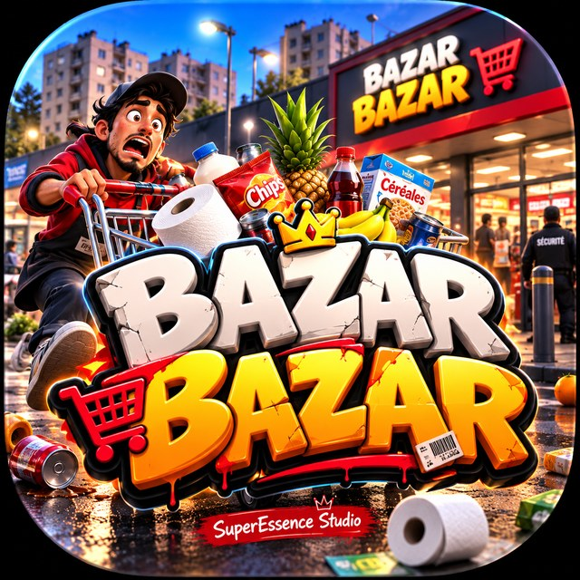

<p align="center"></p>

# BAZAR BAZAR : LA SUPÉRETTE DE L'ENFER

*Un jeu **SuperEssence Studio**.* Simulation de supérette en 3D dans une banlieue française vivante :
vous reprenez une petite supérette, remplissez les rayons carton par carton, tenez la caisse, commandez
aux fournisseurs, embauchez, affrontez les concurrents, surveillez les voleurs… et agrandissez jusqu'à la grande surface.

Le jeu tourne dans le navigateur (WebGL) : **three.js** pour la 3D, **Rapier** pour la physique, **TypeScript** + **Vite**.

## Lancer le jeu

Prérequis : Node.js 20+ et un navigateur récent avec WebGL 2 (Chrome, Edge, Firefox).

```bash
npm install
npm run dev          # serveur de développement → http://localhost:5173
```

Version optimisée (build web statique, jouable hors ligne une fois servie) :

```bash
npm run build        # produit le dossier dist/
npm run preview      # sert dist/ sur http://localhost:4173
```

Le dossier `dist/` est un **build web autonome** : il peut être déposé sur n'importe quel hébergement statique
(GitHub Pages, Netlify, serveur Apache/Nginx). Il n'y a pas d'exécutable natif.

Paramètres d'URL utiles : `?nosplash` (passe l'écran du studio), `?lowgfx` (rendu allégé pour machines sans GPU).

## Commandes

| Action | Touche (par défaut, positions physiques) |
|---|---|
| Se déplacer | ZQSD (AZERTY) / WASD (QWERTY) · Maj : courir · Espace : sauter |
| Regarder | Souris (cliquez dans la fenêtre pour capturer le pointeur) |
| Interagir / prendre / remplir (maintenir) / scanner | **E** |
| Action secondaire (ouvrir un carton, assigner un produit, ouvrir/fermer une caisse) | **F** |
| Prix & promo du produit visé | **R** |
| Lâcher l'objet | **G** · clic gauche : lancer un article / pousser un chariot · clic droit : lancer un carton |
| Tablette de gestion | **Tab** |
| Mode construction | **B** (clic : poser, R : pivoter, clic droit + glisser : tourner, molette : zoom, Suppr : vendre) |
| Écrans de surveillance | **C** |
| Vue 1ʳᵉ / 3ᵉ personne | **V** |
| Vitesse du temps | **T** (pause, ×1, ×2, ×4, ×8) |
| Quitter la caisse | **Q** |
| Pause / menu | **Échap** |

Toutes les touches sont reconfigurables (Options → Commandes).

## Ce qui est réellement implémenté

**Monde 3D et physique**
- Quartier complet : avenue, rues, trottoirs, passages piétons, cité HLM, centre-ville avec commerces, quartier pavillonnaire aisé, stade, gymnase, arrêt de bus, lampadaires, arbres, parkings.
- Cycle jour/nuit (soleil, ciel, étoiles, fenêtres qui s'allument), météo (pluie, orage avec éclairs, neige, canicule).
- Physique Rapier : produits tombés, cartons, palettes, chariots (dont un à roue folle), objets fragiles qui se brisent (salissure + perte), pyramides de présentoir qui s'effondrent, caddies des clients qui bousculent les objets.
- Joueur : contrôleur de personnage physique (collisions, marches), vue 1ʳᵉ/3ᵉ personne, porte jusqu'à 3 cartons (vitesse selon le poids).

**Magasin et stock réel**
- 4 paliers d'agrandissement (supérette → grande surface) avec travaux, terrains à acheter, déplacement automatique de la réserve.
- 35 équipements + 11 améliorations : gondoles, froid (armoires, meubles ouverts, congélateurs), caisses, caisses automatiques, réserve, chambre froide, sécurité, personnel, services, déco, éclairage.
- Construction sur grille avec règles réelles : zones vente/réserve, murs, portes à dégager, accès aux faces des rayons, accessibilité depuis l'entrée vérifiée (parcours en largeur).
- 77 références produits avec dimensions, poids, coût, prix de marché, DLC, conditions de stockage, fragilité.
- Chaque unité en rayon est un objet 3D (rendu instancié) : les rayons se vident réellement, se remplissent unité par unité, par lots avec dates de péremption ; étiquettes de prix (promo, anti-gaspi) sur chaque facing.

**Clients, employés, caisses**
- ~700 habitants persistants (archétype, budget, sensibilité au prix, fidélité, mémoire, amis) qui choisissent chaque jour entre votre magasin et les concurrents (modèle logit : prix, choix, réputation, distance, promos, notoriété).
- Clients 3D animés : arrivent à pied ou en voiture (ils se garent), les passants et voyageurs du bus entrent parfois sur un coup de tête ; ils cherchent, comparent, renoncent, s'impatientent, glissent, abandonnent leur panier, achètent sur un coup de tête, volent.
- Caisses : file d'attente, scan article par article (caissier, vous ou caisse automatique avec « article inattendu »), ticket exact (3 pour 2, 2ᵉ à −50 %, remises, anti-gaspi, fidélité).
- Employés incarnés (caissier, rayon, logisticien, entretien, sécurité, manager) : planning, salaire, compétence, humeur, fatigue, pauses, traits (zélé, maladroit…), formation, démission ; ils portent des cartons, remplissent, rangent les livraisons, nettoient, poursuivent les voleurs.

**Économie, fournisseurs, marketing, concurrence**
- 6 fournisseurs (prix, délais, fiabilité, minimum, remises volume), contrats négociés, retards, livraison physique par camion au quai sur palettes, réapprovisionnement automatique (logiciel + compétence du logisticien).
- Comptabilité : grand livre journalier, coût des ventes, salaires à la minute, loyer, électricité (kWh réels), entretien, assurance, impôts hebdomadaires, emprunts, faillite.
- Promotions (%, 3 pour 2, 2ᵉ −50 %, vente flash, anti-gaspi), campagnes (flyers, radio, réseaux, affiches…), programme de fidélité.
- 5 concurrents simulés (finances, prix, promos, réactions à votre part de marché, faillites, ouverture d'un hypermarché au jour 35).

**Sécurité et événements**
- Caméras avec vraie couverture (lancer de rayons, occlusion par les meubles hauts, angles morts visualisés), écrans de surveillance en direct, vigiles avec ligne de vue, portiques antivol, étiquettes, alarme, détecteurs, coffre, assurance, plaintes avec preuve vidéo.
- 19 événements avec causes, conséquences et choix : match au stade, produit viral, pannes de froid/caisse, coupure de courant, contrôles sanitaire et sécurité (vrais critères), client furieux, influenceur, rôdeurs, proposition douteuse (fiction), chat mascotte, fête de quartier, canicule, commande spéciale… + cambriolages nocturnes (cambrioleurs incarnés si vous êtes sur place, résolution abstraite si vous sautez la nuit).

**Interface, audio, sauvegardes**
- Menu principal comique animé en 3D (pluie de produits physiques, caddie fou, glissade sur banane) avec le logo officiel ; écran SuperEssence Studio.
- HUD minimal + actions contextuelles, tablette de gestion à 12 onglets, tutoriel guidé par les actions.
- Audio 100 % procédural (Web Audio) : bips, tiroir-caisse, frigos, foule, rue, pluie, sirènes, 5 musiques génératives, annonces micro en synthèse vocale ; mixage par catégorie.
- Sauvegardes versionnées avec migrations, 3 emplacements + automatique, copie de secours, export/import JSON.
- Options : graphismes, audio, touches, accessibilité (animations réduites, taille d'interface, bulles), gameplay.

## Tests

```bash
npm test                 # tests unitaires + intégration headless (simulation complète sans rendu)
npm run build && npm run e2e   # test de bout en bout dans Chromium (menu, partie, caisse, tablette, construction, sauvegarde)
```

Voir `docs/DEVLOG.md` pour l'état détaillé, les résultats de tests, les limites et la feuille de route.

## Structure

```
src/
  core/      utilitaires (bus d'événements, RNG déterministe, maths, temps)
  data/      données extensibles : produits, équipements, fournisseurs, archétypes, rôles, concurrents, quartier…
  sim/       simulation pure (testable sans rendu) : stock, prix, économie, marché, RH, sécurité, événements, sauvegarde…
  physics/   enveloppe Rapier
  world/     rendu 3D : ville, bâtiment du magasin, équipements, produits instanciés, textures procédurales, ciel
  entities/  personnages riggés procéduraux, animation, clients, employés, véhicules, objets physiques
  game/      orchestrateur, caisses, tâches du personnel, sécurité en jeu
  player/    contrôleur du joueur, entrées, interactions contextuelles
  build/     mode construction
  ui/        HUD, tablette, menus, scène du menu, caméras
  audio/     moteur audio procédural
  save/      sauvegardes et migrations
public/brand/  logo officiel, logo vectoriel, icône, logo SuperEssence Studio
scripts/       génération du logo vectoriel, rendu PNG, test e2e
tests/         tests Vitest
```

## Crédits

SuperEssence Studio. Technologies : three.js (MIT), Rapier (Apache-2.0), Vite (MIT).
Polices : Luckiest Guy et Nunito (SIL Open Font License). Tous les modèles 3D, textures, sons et musiques sont générés procéduralement par le code du jeu.
