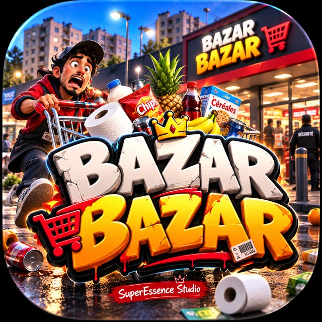

<p align="center"></p>

# BAZAR BAZAR — la supérette tranquille

*Un jeu **SuperEssence Studio**.* Gérez une petite supérette de quartier en 3D, **seul ou à deux, chacun sur son
écran** (deux téléphones, deux PC, ou un de chaque), dans le même magasin.

Version 2 : refonte complète, plus simple, plus calme et plus complète, avec de **vrais modèles 3D** :

- personnages humains animés (marche, geste pour prendre un article, salut…) : Quaternius, licence CC0 ;
- rue, voitures, immeubles, lampadaires, mobilier et cagettes : packs KayKit, licence CC0 ;
- mobilier de supérette (gondoles, frigos, congélateur, caisses, racks) modélisé sous Blender pour le jeu ;
- produits en rayon en 3D (bouteilles, canettes, boîtes, fruits…) avec leur étiquette illustrée.

## Comment on joue

Quatre gros boutons en bas, c'est tout :

| Bouton | Ce qu'il fait |
|---|---|
| 🛒 **Commander** | Choisir des cartons de produits. Une camionnette les livre dans la réserve. Le **réassort automatique** (activé par défaut) recommande tout seul ce qui est en rayon. |
| 🏗️ **Construire** | Rayons, frigos, caisses, racks de réserve, déco, agrandissement. Touchez le sol pour placer, **Tourner**, **Poser ici**. |
| 👥 **Équipe** | Embaucher un·e caissier·ère ou un·e employé·e de rayon (salaire payé le soir). |
| ⚙️ **Menu** | Inviter un ami, options, musique, retour au menu. |

- **Votre perso** (anneau de couleur sous les pieds) se débrouille seul : il encaisse quand des clients attendent
  et remplit les rayons depuis la réserve. Touchez le sol pour l'envoyer quelque part, ou touchez une caisse /
  un rayon → « J'y vais » / « Remplir ».
- **Touchez un meuble** : choisir le produit d'un rayon, le remplir, le tourner, le déplacer ou le revendre (50 %).
- Le magasin ouvre de **8 h à 20 h** (une journée ≈ 6 minutes) ; le soir, un petit bilan s'affiche.
- Les clients cherchent les produits que vous vendez ; une bulle avec ✕ = produit introuvable ou rayon vide.
  Les étoiles montent quand ils trouvent tout et n'attendent pas.
- Chaque vente donne de l'expérience. Les **niveaux** débloquent des familles de produits, des meubles et des
  agrandissements (et une prime) :

  | Niveau | Produits | Meubles |
  |---|---|---|
  | 1 | Boissons, snacks, confiserie, épicerie | Étagère, gondole double, présentoir, caisse, rack, déco |
  | 2 | Petit-déjeuner, boulangerie | Gondole basse, corbeilles à pain, ballons, lampadaire, cagettes · agrandissement |
  | 3 | Fruits & légumes, hygiène | Étal fruits & légumes, chariots, grand tapis |
  | 4 | Crèmerie, produits ménagers | Frigo vitré, canapé · agrandissement |
  | 5 | Surgelés | Congélateur, étagère déco |
  | 6 | Boucherie | Meuble froid ouvert, machine à café · agrandissement |
  | 7 | Produits locaux | Caisse automatique |
  | 8 | Saisonnier | |

Pas de vol, pas de panne, pas de déchets, pas de faillite brutale : c'est un jeu **tranquille**.

## Jouer à deux (chacun sur son écran)

1. Joueur 1 : **Jouer à deux → Créer**. Un **code de 4 lettres** s'affiche (aussi dans *Menu*).
2. Joueur 2 : **Jouer à deux → Rejoindre**, tape le code.
3. C'est parti : même magasin, même caisse, chacun son perso (son prénom au-dessus de la tête), chacun sa caméra
   et ses menus. Tout ce que l'un construit, commande ou embauche apparaît tout de suite chez l'autre.

Détails : connexion directe entre les deux appareils (WebRTC via PeerJS ; le serveur public PeerJS sert juste à se
retrouver grâce au code). Les deux appareils doivent avoir Internet. L'hôte fait tourner le magasin et le
sauvegarde ; si l'hôte quitte, l'invité est prévenu et revient au menu. Si l'invité se déconnecte, l'hôte continue
seul et l'ami peut revenir avec le même code.

## Lancer le jeu

Prérequis : Node.js 20+ et un navigateur avec WebGL 2.

```bash
npm install
npm run dev          # http://localhost:5173
```

```bash
npm run build        # build web autonome dans dist/
npm run preview      # http://localhost:4173
```

### Android (APK)

Chaque push sur la branche de développement lance le workflow « APK Android » (`.github/workflows/android.yml`) :
tests, build, puis `BazarBazar.apk` publié dans les **Releases** du dépôt. Installez-la sur les deux téléphones
(autoriser « Installer des applis inconnues »). Android 7+, WebGL 2. Bouton retour = fermer / menu.

## Commandes

| Action | Souris / clavier | Doigt |
|---|---|---|
| Déplacer la vue | glisser · flèches / ZQSD | glisser |
| Zoom | molette · + / − | pincer · boutons ＋ － |
| Tourner la vue | R · bouton ⟳ | bouton ⟳ |
| Recentrer | bouton ⌖ | bouton ⌖ |
| Sélectionner / envoyer son perso | clic | toucher |
| Pause | Espace · ❚❚ | ❚❚ |
| Fermer / menu | Échap | retour Android |

## Code

| Dossier | Rôle |
|---|---|
| `src/sim/` | Simulation pure, sans affichage (clients, employés, avatars, livraisons, journée, niveaux, chemins A*), testée en Node. Toute modification passe par `Sim.apply(joueur, action)`. |
| `src/net/` | Jeu à deux : hôte qui diffuse l'état (~10 fois/s), invité qui envoie ses actions. |
| `src/render/` | Affichage three.js (caméra isométrique orthographique), modèles, vignettes, contrôles. |
| `src/ui/` | Interface (HUD, feuilles Commander/Construire/Équipe, panneaux, cartes). |
| `src/session.ts` | Une partie vue depuis cet écran (seul / hôte / invité). |
| `scripts/build-assets.mjs` | Prépare les modèles CC0 (fusion, allègement, animations partagées). |

## Tests

- `npm test` : 11 tests de simulation, dont une journée complète, livraison, remplissage, construction et
  accessibilité, niveaux, deux joueurs, sauvegarde, et un **test « chaos »** (milliers d'actions au hasard de deux
  joueurs pendant 4 jours, sans erreur ni incohérence).
- `npm run build && npm run e2e` : dans Chromium, avec un serveur PeerJS local et **deux navigateurs séparés**
  (un en écran de PC, un en téléphone vertical) : code de partie, connexion, meuble posé par l'invité vu par l'hôte,
  commande partagée, clients et vitesse synchronisés, avatar de l'invité qui remplit un rayon, départ de l'hôte
  signalé ; puis partie seule (construction, embauche, menu, sauvegarde/reprise) et aucune erreur JavaScript.

## Crédits

Musiques composées pour le jeu (`public/music/CREDITS.txt`). Icônes et images produits : Microsoft Fluent Emoji
(MIT). Modèles 3D : voir `public/models/CREDITS.txt` (Quaternius, KayKit — CC0). Polices Luckiest Guy et Nunito (OFL).
