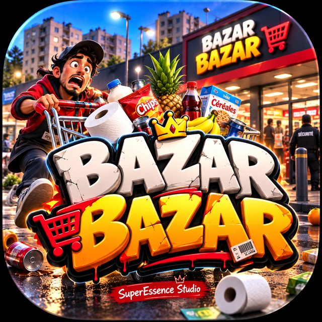

<p align="center"></p>

# BAZAR BAZAR : LA SUPÉRETTE DE L'ENFER

*Un jeu **SuperEssence Studio**.* Simulation de supérette en **2.5D** (vue isométrique, modèles 3D faits sous
**Blender**) dans une banlieue française vivante, avec une interface de **jeu mobile** : gros boutons, grandes images,
peu de texte. Vous démarrez dans un petit local avec une caisse, un rayon et quelques cartons ; vous vendez, commandez,
construisez, embauchez (CDI ou CDD)… et **montez de niveau** pour débloquer de nouveaux produits et de nouveaux meubles.

Le jeu tourne dans le navigateur (WebGL) : **three.js** pour le rendu, **Rapier** pour la physique, **TypeScript** + **Vite**,
et sur Android (APK).

### Comment on joue

La barre du bas a quatre boutons : **🛒 Commander**, **🏗️ Construire**, **👥 Équipe**, **⚙️ Menu**.

1. **Remplir** : touchez votre rayon → « 📦 Remplir depuis la réserve ». Le patron va chercher les cartons et remplit
   unité par unité. Au départ il n'y a que quelques cartons : le stock n'est pas illimité.
2. **Ouvrir** : bouton **🔓 OUVRIR** en haut. Sans caissier·ère, le patron tient la caisse : tapez **SCANNER**.
3. **Commander** : choisissez une famille (images), touchez **+** sur les produits, puis **Commander**. Prix au carton,
   livraison 15 € (offerte dès 250 €). Un **livreur** arrive à pied 20 à 60 minutes de jeu plus tard avec son diable
   et range lui-même les cartons dans la réserve (le surplus est posé au sol si la réserve est pleine).
4. **Construire** : rayons, froid, caisses, réserve, déco… avec la vignette de chaque meuble. Touchez « Acheter »,
   puis le sol (aperçu) et encore le sol (pose). « ✋ Déplacer mes meubles » pour réorganiser ou revendre.
5. **Équipe** : publiez une annonce (caissier·ère, rayon, logistique, entretien, sécurité, manager), puis embauchez
   un candidat en **CDI** (période d'essai de 7 jours, puis indemnité en cas de licenciement, moral en hausse) ou en
   **CDD** de 7, 14 ou 30 jours (renouvelable 2 fois, prime de précarité de 10 % à la fin, passage en CDI possible ;
   certains candidats n'acceptent qu'un CDI).
6. **Niveaux ⭐** : chaque article vendu et chaque client servi rapporte de l'expérience. Les niveaux débloquent :

   | Niveau | Produits | Meubles |
   |---|---|---|
   | 1 | Épicerie, boissons, snacks, confiserie | Gondoles, présentoir promo, caisse, rack |
   | 2 | Petit-déjeuner, boulangerie | Corbeilles à pain, spots, panneaux |
   | 3 | Fruits & légumes, hygiène | Étal fruits & légumes, range-caddies, néon |
   | 4 | Crèmerie, produits ménagers | Armoire réfrigérée, chambre froide, caméras, casiers |
   | 5 | Surgelés | Congélateur, poste de surveillance, coin pause |
   | 6 | Boucherie | Meuble froid ouvert, portique antivol, bureau, coffre |
   | 7 | Produits locaux | Machine à café, détecteurs, vitrine sécurisée, toilettes |
   | 8 | Saisonnier | Caisse automatique |

   Chaque niveau verse aussi une prime. Les clients ne cherchent que les familles que vous vendez.

Le **Menu** donne accès à la sauvegarde, aux options et à la **gestion avancée** (tablette : prix, promotions,
marketing, finances, concurrence, sécurité, agrandissements…).

## Lancer le jeu

Prérequis : Node.js 20+ et un navigateur récent avec WebGL 2 (Chrome, Edge, Firefox).

```bash
npm install
npm run dev          # serveur de développement → http://localhost:5173
```

Version optimisée (build web statique, jouable hors ligne une fois servie) :

```bash
npm run build        # produit le dossier dist/
npm run preview      # sert dist/ sur http://localhost:4173
```

Le dossier `dist/` est un **build web autonome** : il peut être déposé sur n'importe quel hébergement statique
(GitHub Pages, Netlify, serveur Apache/Nginx).

### Android (APK)

Le jeu est aussi emballé en **application Android** (Capacitor : le même jeu dans une WebView plein écran, en paysage).

- **Télécharger** : chaque push déclenche le workflow GitHub Actions « APK Android » (`.github/workflows/android.yml`),
  qui lance les tests, compile l'APK et la publie dans les **Releases** du dépôt (`BazarBazar.apk`,
  aussi disponible comme artefact du workflow).
- **Installer** : ouvrir `BazarBazar.apk` sur le téléphone et autoriser « Installer des applis inconnues ».
  Android 7.0 minimum, WebGL 2 requis.
- **Compiler soi-même** (Android Studio ou SDK Android + JDK 21) :
  ```bash
  npm run android:sync                   # build web + copie dans android/
  cd android && ./gradlew assembleDebug  # → android/app/build/outputs/apk/debug/app-debug.apk
  ```
- L'APK est signée avec une clé de développement fournie dans le dépôt (`android/app/bazarbazar-debug.keystore`) :
  les nouvelles versions s'installent par-dessus les anciennes sans perdre les sauvegardes. Pour le Play Store,
  il faudra une vraie clé de publication.
- Bouton retour Android = Échap (pause / fermer un panneau) ; la partie est sauvegardée automatiquement quand l'appli passe en arrière-plan.
- Icônes et écran de démarrage générés depuis le logo officiel : `npm run android:assets`.

Paramètres d'URL utiles : `?nosplash` (passe l'écran du studio), `?lowgfx` (rendu allégé pour machines sans GPU).

## Commandes

Tout se joue au doigt ou à la souris, la même chose sur PC, téléphone et dans l'appli Android :

| Action | Souris / clavier | Doigt |
|---|---|---|
| Déplacer la vue | glisser · flèches / ZQSD / WASD | glisser |
| Zoomer / dézoomer | molette · **+** / **−** · boutons ＋ － ⤢ à droite | pincer · boutons ＋ － ⤢ |
| Tourner la vue (quart de tour) | **R** (Maj+R : sens inverse) · bouton ⟳ | bouton ⟳ |
| Envoyer le patron quelque part | clic sur le sol | toucher le sol |
| Sélectionner (rayon, réserve, caisse, palette, client, employé, salissure, patron) | clic | toucher |
| Commander / Construire / Équipe / gestion avancée | **G** / **B** / **E** / **Tab** | barre du bas (4 gros boutons) |
| Scanner en caisse | bouton SCANNER · **Espace** | bouton SCANNER |
| Construire : poser / pivoter / annuler | clic · **R** · **Échap** | toucher = aperçu, retoucher = poser |
| Vitesse du temps | **T** · pastille en haut (⏸ ×1 ×2 ×4 ×8) | pastille |
| Pause / fermer un panneau | **Échap** | bouton Menu / retour Android |

## Ce qui est réellement implémenté

**Vue 2.5D et modèles Blender**
- Caméra isométrique orthographique (déplacement, zoom au pincement, rotation par quarts de tour), murs et toit
  coupés automatiquement du côté de la caméra pour voir l'intérieur.
- 35 meubles modélisés sous Blender par script (`blender/equipment_kit.py` → `public/models/equipment.glb`),
  aux cotes exactes du jeu (tablettes aux hauteurs réelles des facings) ; personnages en pièces Blender
  (`blender/character_kit.py` → `public/models/characters.glb`) animées par le squelette du jeu.
- Le patron est piloté par ordres (aller, remplir, ranger, tenir la caisse, nettoyer, aller voir un client) et
  les exécute physiquement : chemin, cartons portés, remplissage unité par unité, dégagement automatique s'il est bloqué.

**Monde 3D et physique**
- Quartier complet : avenue, rues, trottoirs, passages piétons, cité HLM, centre-ville avec commerces, quartier pavillonnaire aisé, stade, gymnase, arrêt de bus, lampadaires, arbres, parkings.
- Cycle jour/nuit (soleil, ciel, étoiles, fenêtres qui s'allument), météo (pluie, orage avec éclairs, neige, canicule).
- Physique Rapier : produits tombés, cartons, palettes, chariots (dont un à roue folle), objets fragiles qui se brisent (salissure + perte), pyramides de présentoir qui s'effondrent, caddies des clients qui bousculent les objets.
- Logistique au chariot : posez jusqu’à 6 cartons dans un chariot (E en tenant un carton), poussez-le jusqu’aux rayons puis reprenez-les un par un (**F**). Le chargement est conservé dans les sauvegardes.
- Patron : contrôleur de personnage physique (collisions), porte jusqu'à 6 cartons sur son diable.

**Magasin et stock réel**
- 4 paliers d'agrandissement (supérette → grande surface) avec travaux, terrains à acheter, déplacement automatique de la réserve.
- 35 équipements + 11 améliorations : gondoles, froid (armoires, meubles ouverts, congélateurs), caisses, caisses automatiques, réserve, chambre froide, sécurité, personnel, services, déco, éclairage.
- Construction sur grille avec règles réelles : zones vente/réserve, murs, portes à dégager, accès aux faces des rayons, accessibilité depuis l'entrée vérifiée (parcours en largeur).
- 77 références produits avec dimensions, poids, coût, prix de marché, DLC, conditions de stockage, fragilité.
- Chaque unité en rayon est un objet 3D (rendu instancié) : les rayons se vident réellement, se remplissent unité par unité, par lots avec dates de péremption ; étiquettes de prix (promo, anti-gaspi) sur chaque facing.

**Clients, employés, caisses**
- ~700 habitants persistants (archétype, budget, sensibilité au prix, fidélité, mémoire, amis) qui choisissent chaque jour entre votre magasin et les concurrents (modèle logit : prix, choix, réputation, distance, promos, notoriété).
- Clients 3D animés : arrivent à pied ou en voiture (ils se garent), les passants et voyageurs du bus entrent parfois sur un coup de tête ; ils cherchent, comparent, renoncent, s'impatientent, glissent, abandonnent leur panier, achètent sur un coup de tête, volent.
- Caisses : file d'attente, scan article par article (caissier, vous ou caisse automatique avec « article inattendu »), ticket exact (3 pour 2, 2ᵉ à −50 %, remises, anti-gaspi, fidélité).
- Employés incarnés (caissier, rayon, logisticien, entretien, sécurité, manager) : planning, salaire, compétence, humeur, fatigue, pauses, traits (zélé, maladroit…), formation, démission ; ils portent des cartons, remplissent, rangent les livraisons, nettoient, poursuivent les voleurs.

**Économie, fournisseurs, marketing, concurrence**
- 6 fournisseurs (prix, délais, fiabilité, minimum, remises volume), contrats négociés, retards, livraison physique par camion au quai sur palettes, réapprovisionnement automatique (logiciel + compétence du logisticien).
- Comptabilité : grand livre journalier, coût des ventes, salaires à la minute, loyer, électricité (kWh réels), entretien, assurance, impôts hebdomadaires, emprunts, faillite.
- Promotions (%, 3 pour 2, 2ᵉ −50 %, vente flash, anti-gaspi), campagnes (flyers, radio, réseaux, affiches…), programme de fidélité.
- 5 concurrents simulés (finances, prix, promos, réactions à votre part de marché, faillites, ouverture d'un hypermarché au jour 35).

**Sécurité et événements**
- Caméras avec vraie couverture (lancer de rayons, occlusion par les meubles hauts, angles morts visualisés), écrans de surveillance en direct, vigiles avec ligne de vue, portiques antivol, étiquettes, alarme, détecteurs, coffre, assurance, plaintes avec preuve vidéo.
- 19 événements avec causes, conséquences et choix : match au stade, produit viral, pannes de froid/caisse, coupure de courant, contrôles sanitaire et sécurité (vrais critères), client furieux, influenceur, rôdeurs, proposition douteuse (fiction), chat mascotte, fête de quartier, canicule, commande spéciale… + cambriolages nocturnes (cambrioleurs incarnés si vous êtes sur place, résolution abstraite si vous sautez la nuit).

**Interface, audio, sauvegardes**
- Menu principal par-dessus le magasin vivant (clients, rotation lente de la vue) avec le logo officiel ; écran SuperEssence Studio.
- HUD de commerçant (heure, caisse, vitesse, OUVRIR/FERMER, outils), panneaux contextuels, boutique du grossiste
  (marchandises, matériel, suivi des commandes), tablette de gestion à 12 onglets, tutoriel du commerçant guidé par les actions.
- Audio 100 % procédural (Web Audio) : bips, tiroir-caisse, frigos, foule, rue, pluie, sirènes, 5 musiques génératives, annonces micro en synthèse vocale ; mixage par catégorie.
- Sauvegardes versionnées avec migrations, 3 emplacements + automatique, copie de secours, export/import JSON.
- Options : graphismes, audio, touches, accessibilité (animations réduites, taille d'interface, bulles), gameplay.

## Personnages

En 2.5D, clients, employés, passants et le patron sont assemblés à partir du **kit Blender** (`public/models/characters.glb`) :
silhouettes stylisées, grands yeux, sourcils et bouche animés, coiffures, chapeaux, vêtements et uniformes recolorés à la volée,
diversité de morphologies et de teintes de peau. Régénérer : `/root/bpyenv/bin/python blender/character_kit.py`
(module `bpy` de Blender 5, installable avec `pip install bpy` sous Python 3.11). Même chose pour le matériel
(`blender/equipment_kit.py`, après `npx tsx scripts/export-spec.ts` qui exporte les cotes du jeu).

L'ancien kit d'**humains réalistes** reste disponible : il est fabriqué à la volée à partir d'un
« kit humain » (`public/humans/`, 1,8 Mo) généré depuis les données **CC0 de MakeHuman** par `scripts/build-humans.mjs` :

- **morphologie** : sexe, âge (ados → seniors), musculature, corpulence, taille, ventre ;
- **origines mélangées** (africaine, maghrébine, asiatique, européenne, métisse) avec teintes de peau, cheveux et yeux cohérents ;
- **visage unique** : 24 curseurs (nez, lèvres, menton, mâchoire, oreilles, yeux, pommettes, sourcils…) ;
- **vêtements en pièces séparées** découpées sur le corps avec des ourlets nets (t-shirt, chemise à boutons, pull col roulé, hoodie et veste à fermeture éclair, doudoune matelassée, robe, jupe, short, jogging, pantalon ample, chaussures à semelle, tablier et gilet d'uniforme), tissu lissé et légèrement ample ; cheveux modelés sur le crâne (court, carré long, chignon, queue, tresses, afro), barbe, lunettes, casquette, bonnet, foulard, béret, casque ;
- **matières** : yeux brillants, peau satinée, tissus mats (rugosité par sommet) ;
- **expressions** par morph targets (sourire, tristesse, colère, surprise, bouche qui parle, clignement des yeux), désactivées en qualité basse ;
- même squelette à 21 os et mêmes animations qu'avant (marche, course, gestes, actions).

Aperçu : `npm run build && npm run preview`, puis ouvrir `http://localhost:4173/?nosplash&gallery=1&n=10`
(ajouter `&close` pour un gros plan, `&actions` pour les expressions et gestes, `&hair` pour les coiffures).
Regénérer le kit : `node scripts/build-humans.mjs <dossier makehuman/data>` (dépôt https://github.com/makehumancommunity/makehuman).

## Tests

```bash
npm test                 # tests unitaires + intégration headless (simulation complète sans rendu)
npm run build && npm run e2e   # bout en bout dans Chromium : rayons vides → grossiste → livraison → rangement → rayon → ouverture → caisse → embauche → matériel → sauvegarde
npm run e2e:mobile             # émulation téléphone tactile : glisser, pincer, toucher le sol / un rayon, boutique plein écran, pose d'un meuble au doigt
```

Voir `docs/DEVLOG.md` pour l'état détaillé, les résultats de tests, les limites et la feuille de route.

## Structure

```
src/
  core/      utilitaires (bus d'événements, RNG déterministe, maths, temps)
  data/      données extensibles : produits, équipements, fournisseurs, archétypes, rôles, concurrents, quartier…
  sim/       simulation pure (testable sans rendu) : stock, prix, économie, marché, RH, sécurité, événements, sauvegarde…
  physics/   enveloppe Rapier
  world/     rendu 3D : ville, bâtiment du magasin, équipements, produits instanciés, textures procédurales, ciel
  entities/  personnages riggés procéduraux, animation, clients, employés, véhicules, objets physiques
  game/      orchestrateur, caisses, tâches du personnel, sécurité en jeu
  player/    contrôleur du joueur, entrées, interactions contextuelles
  build/     mode construction (aménagement)
  iso/       vue 2.5D : caméra isométrique, contrôles, sélection, patron piloté, panneaux, boutique du grossiste
  models/    chargement des modèles Blender (GLB)
  ui/        HUD, tablette, menus, caméras
  audio/     moteur audio procédural
  save/      sauvegardes et migrations
public/brand/  logo officiel, logo vectoriel, icône, logo SuperEssence Studio
public/models/ modèles Blender exportés (personnages, matériel)
blender/       scripts Blender (bpy) qui génèrent les modèles
scripts/       génération du logo vectoriel, rendu PNG, test e2e
tests/         tests Vitest
```

## Crédits

SuperEssence Studio. Technologies : three.js (MIT), Rapier (Apache-2.0), Vite (MIT).
Polices : Luckiest Guy et Nunito (SIL Open Font License). Images des produits et icônes de l'interface :
**Microsoft Fluent Emoji 3D** (licence MIT, `public/products/CREDITS.txt`). Modèles 3D générés par les scripts Blender du dépôt ;
textures, sons et musiques générés procéduralement par le code du jeu.
